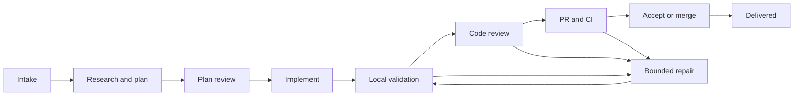
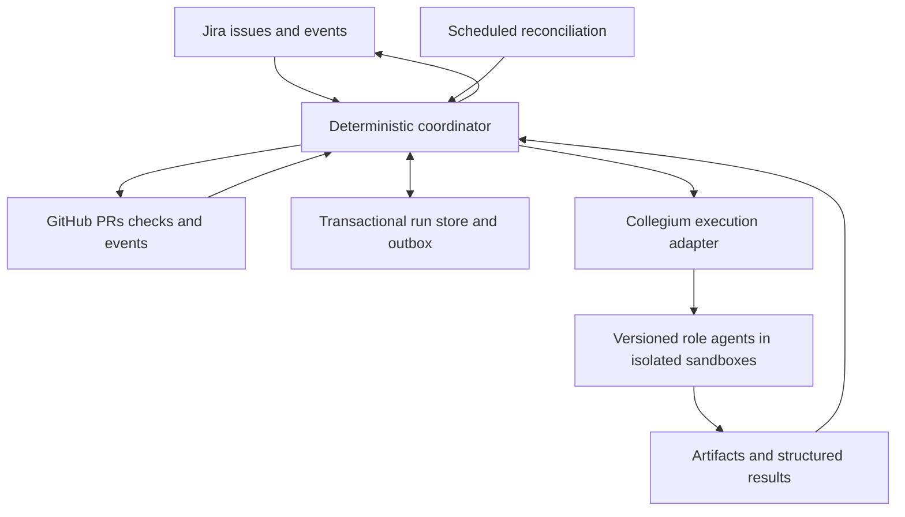

# Collegium Delivery Pipeline — specification

Version: 0.1.0-draft · 2026-11-27

## 1. Purpose and decisions

Build a native Collegium pipeline that can investigate a problem, prepare an actionable design, deliver a Jira epic through several dependent tickets, or deliver one Jira ticket. Preserve quality through independent review, reproducible checks, bounded repair and explicit acceptance evidence.

Confirmed by the owner:

- Independent project at `/Volumes/KINGSTON/collegium-pipeline`.
- Jira is the source of epics, tickets, requirements and business status.
- GitHub is the source of code, pull requests, review and CI state.
- Both epics and single tickets are first-class inputs; independent tickets may run concurrently.
- Model and reasoning effort selection, quality policy and operational settings are part of the product.
- Current project development is ticketless. A text-task entry is supported for the pilot; it does not create a Jira issue.

The architecture and defaults below are **proposals**, ready for implementation review. This draft is not an accepted architecture decision or permission to merge arbitrary repositories.

Out of scope for the initial release: production deployment, autonomous product prioritization, arbitrary repository discovery, replacing Jira/GitHub, a general agent platform, Remote Sessions integration, importing Shipyard's runtime or migrating existing Shipyard runs.

## 2. Entry points and execution model

One reusable ticket engine serves three entry points. An epic adds a coordinator around that engine; it does not duplicate delivery logic.

| Entry | Required input | Result |
|---|---|---|
| Investigate | problem or Jira issue, repository scope, constraints | sourced findings, options, risks, open questions, proposed decision and decomposition |
| Deliver text task | explicit task text, acceptance and configured repository | same delivery engine without a tracker write |
| Deliver ticket | Jira key and configured repository mapping | independently reviewed PR, evidence and mapped Jira status |
| Deliver epic | Jira epic key and configured repository mapping | dependency graph, ticket runs, integration PR and epic-level evidence |

Logical API/CLI commands to implement: `investigate`, `plan-epic`, `deliver-ticket`, `deliver-text`, `deliver-epic`, `status`, `pause`, `resume`, `cancel`, `retry`, `explain-route`, `config validate`, `doctor`. These are pipeline commands, not existing `lap` commands. The current prototype implements only the subset documented in PROTOTYPE.md.

All entry points start with authentication, authorization, repository allowlist, tracker snapshot and capability checks. `dry_run` may read and produce a plan; it must not create Jira tickets, run paid agents, push branches or create PRs. External writes require an enabled action policy and a recorded admission decision.

## 3. Investigation and decomposition

Investigation is required for unclear acceptance criteria, unresolved architecture, unknown failure mechanism, consequential cross-component changes or an explicit request. A clear ticket may proceed directly to delivery planning. Classification must explain the evidence and allow an operator override within configured limits.

Investigation stages:

1. Intake: user/problem, current behavior, desired outcome, constraints, success criteria and scope boundaries. Ask only for information unavailable from the issue and connected sources.
2. Research four perspectives: current system, alternatives, constraints and failure/security risks. Parallel research is optional and bounded; each result carries sources, observations, uncertainty and a status.
3. Synthesis: compare options, identify conflicts and distinguish verified facts from assumptions.
4. Decision: present a proposed ADR with tradeoffs and unresolved questions. A configured human decision closes consequential open choices; agent prose cannot manufacture that approval.
5. Decomposition: produce implementation tickets with acceptance criteria, dependencies, contracts, expected file/component areas, risk and validation commands. Validate the graph before exporting to Jira.

Every investigation stores a versioned artifact set: problem, research, options, risks, decisions, open questions, proposed ADR and ticket graph. Code changes are outside investigation. An inconclusive investigation is `needs_input` or `blocked`, not accepted.

Decomposition export is an explicit action: create Jira issues with a stable pipeline identity and recorded external IDs; retries reconcile before creation. Do not silently rewrite user-owned descriptions. Replanning a running epic produces a new graph version and an impact report; it cannot invalidate active work without pausing affected tickets.

## 4. Common ticket lifecycle

Main path:

Persisted execution states: `queued`, `admitting`, `investigating`, `planning`, `plan_review`, `implementing`, `validating`, `reviewing`, `waiting_ci`, `repairing`, `ready_for_acceptance`, `integrating`, `delivered`, `needs_input`, `blocked`, `paused`, `cancelling`, `cancelled`, `failed`, `reconciling`.

Rules:

- Each transition records previous state, reason, actor, version and evidence references. State transitions are enforced by deterministic code.
- `delivered` means the configured delivery target was achieved: PR accepted for a PR-only policy, or merged for a merge policy. Always display the target; an open PR is not described as merged.
- Jira Done is allowed only after the configured delivery target and acceptance gates pass. Map statuses by discovered transition IDs, never by assumed English names.
- Plan review must reject missing requirements, unverifiable acceptance, excessive scope or unresolved prerequisite contracts.
- A plan defect returns to planning; a local code defect returns to repair; an environment or authorization failure becomes blocked. Increasing effort is not a substitute for diagnosing the failure.
- Exhausted attempts end in failure or an operator checkpoint. No infinite fix/review loop and no lowered gates to obtain a green result.
- Cancel stops new dispatch and requests cancellation of active turns. Existing PRs remain traceable; cancellation does not delete branches or revert merged changes automatically.
- Pause prevents new starts. By default active work drains; a distinct stop-active option requests turn cancellation. Resume revalidates the source and reconciles outstanding work before dispatch.

## 5. Epic coordination and parallel work

The epic coordinator owns a versioned directed acyclic graph. Nodes are ticket runs; edges specify prerequisite deliverables and acceptance conditions. Reject cycles, unknown nodes and ambiguous repository mappings. An empty epic is `needs_input`, not successful.

A ticket is runnable only when all prerequisites are satisfied, its acceptance snapshot is current, its resource claims are available, and global/project/repository/epic limits and budgets permit admission. Priority and aging prevent a large epic from starving single tickets. Both entry points share the same queue and claim registry.

Parallelize by independently deliverable contracts and components. Expected file overlap is a warning/serialization signal, not proof of independence. Shared schema, generated code, lockfiles, migrations or public API changes require an explicit ordering or a shared prerequisite ticket. Unknown overlap defaults to serial execution. If workers discover overlap, pause affected integration and replan.

Each ticket has its own branch, sandbox/worktree and execution context. Default branch names include a stable run identifier; reconcile before creating another. Never share a mutable checkout across concurrent workers. Repository credentials and workspaces are provisioned through Collegium's configured environment and GitHub connection.

Proposed default for an epic: tickets target an epic integration branch; eligible ticket merges are serialized under a repository integration lock. Dependent tickets branch from the accepted integration revision after their prerequisites merge. Independent sibling PRs are rebased or updated and rechecked after the integration base changes. A final epic PR targets the configured base branch. A single ticket targets that base directly.

An alternate `direct_to_base` strategy may be configured explicitly. A ticket's merge strategy is pinned at admission and cannot change mid-run. The same Jira ticket submitted alone and through an epic must resolve to one active canonical delivery run for that repository; the second request attaches to it or reports the ownership conflict.

The integrator checks combined behavior, requirement coverage, dependency contracts, migrations and epic-level tests. All child tickets merged does not by itself complete an epic. A failed child blocks dependent nodes; unrelated siblings may continue if policy and budget allow. Report partial completion explicitly.

## 6. Architecture and Collegium responsibilities

Collegium provides documented agent/session execution, model connections, environments, MCP connections, GitHub access, script automations and versioned bundles. The pipeline must implement dependency scheduling, durable claims, replay, stage contracts, quality enforcement, integration ordering and tracker projection. Do not assume the platform supplies those application semantics.

Proposed control plane: deterministic Python coordinator packaged as a Collegium script automation and invoked on events or a schedule. Python aligns with the documented script examples; exact SDK/API contracts must be verified before implementation. Agent prompts are workers, not the authoritative scheduler.

Proposed durable state: PostgreSQL with transactional compare-and-set claims, run records and an outbox; object storage for immutable artifacts. Database availability, hosting, credentials and allowed network routes remain deployment decisions. Ephemeral sandbox storage and an agent transcript are insufficient as the sole run database. A local SQLite test backend is acceptable only for a single-process prototype and is not evidence of production multi-worker correctness.

Use short reconciliation ticks rather than one immortal coordinator session. An automation's serial queue does not implement ticket parallelism: one dispatcher tick may admit multiple independent jobs, and later ticks reconcile them.

## 7. Consistency, recovery and concurrency contracts

Required records: `PipelineRun`, `EpicGraphVersion`, `TicketSnapshot`, `StageAttempt`, `ResourceClaim`, `DispatchIntent`, `ExternalAction`, `QualityVerdict`, `Artifact`, `Approval`, `EventInbox`, `OutboxEvent`, `ConfigRevision` and `ModelSelection`.

Minimum identity fields include run/attempt IDs, Jira issue ID/key, repository immutable ID, target/base/head revisions, graph/config/acceptance digests, Collegium agent/session/turn IDs, actor and timestamps. Artifact records include content hash, storage location, producer, subject and schema version.

- **Claims:** transactionally admit at most one active ticket delivery per repository and Jira issue ID. Acquire capacity and ticket claims together; leases carry monotonically increasing fencing tokens. Heartbeats cannot revive a superseded lease.
- **Fencing:** every coordinator mutation checks the active token. Workers cannot independently merge or transition Jira Done; the coordinator's action broker verifies the latest claim and evidence immediately before external writes.
- **Launch ambiguity:** persist a dispatch intent before launching. Associate a platform run using a supported correlation mechanism. If the response is lost and the platform cannot prove idempotent launch or find the original turn, enter `reconciling` and require resolution; never blindly relaunch on timeout.
- **External writes:** use deterministic action identities, an outbox, external object markers and read-before-retry reconciliation. Jira/GitHub are not participants in the database transaction. Do not claim distributed exactly-once delivery; ambiguous creates remain visible until resolved.
- **Merge ambiguity:** reconcile the PR's merged state and commit before retrying. Check expected head and current base under the integration lock. A local lease cannot undo an already accepted external request; do not release/reuse an unresolved integration claim.
- **Events:** deduplicate webhook delivery IDs, persist receipt before processing, tolerate duplicates and reordering, and refetch authoritative state before advancing gates.
- **Reconciliation:** poll Jira, GitHub and Collegium for missed callbacks, stalled turns, expired claims and pending outbox items. GitHub events made by the platform's own App may be ignored by its event trigger; self-generated labels/events are not a reliable sole wake-up source.
- **Crash recovery:** after restart reconcile pending launches and actions before dispatching replacements. A crashed worker, expired lease or missing artifact cannot yield success. Keep immutable failed-attempt evidence.
- **Cancellation:** do not release a writer claim until termination is confirmed or quarantine the work as unresolved. Late results are retained but cannot advance a newer attempt.

## 8. Roles, models and effort

Effort is selected per stage and attempt, independently of epic size. An epic may contain simple and complex tickets. Store both the requested selection and the actual platform agent/runtime/configuration used.

Proposed initial policy follows the owner's native Codex ladder. Availability on the selected Collegium runtime and connection remains to be probed; a name in a config file is not capability evidence.

| Role | Model | Base effort | Allowed escalation signal |
|---|---|---|---|
| Researcher | `gpt-6.2-sol` | high | very complex investigation → xhigh |
| Planner / decomposition | `gpt-6.2-sol` | high | critical scope or operator checkpoint → xhigh |
| Executor | `gpt-6.2-sol` | low | critical scope or operator checkpoint → high |
| Architecture reviewer | `gpt-6.2-sol` | high | critical architectural scope → xhigh |
| Code reviewer | `gpt-6.2-sol` | high | critical scope or operator checkpoint → xhigh |
| CI/review fixer | `gpt-6.2-sol` | low | repeated same-class failure → high; exhausted repeat tier → xhigh |
| Integrator | `gpt-6.2-sol` | high | critical, contested integration or operator checkpoint → xhigh |
| Drift checker | `gpt-6.2-sol` | low | fixed; route unresolved findings to the appropriate stage |
| PR sentinel | `gpt-6-luna` | medium | fixed; reports state and dispatches work, does not implement fixes |

The sentinel may be replaced by deterministic polling where no interpretation is required. Reviewer and executor are distinct turns/contexts with distinct permission scopes; the reviewer must inspect code, requirements and validation evidence rather than repeat the executor's self-assessment.

Complexity assessment records impact/risk separately from estimated work: number of components and repositories, dependency uncertainty, public contracts, auth/security, persistence/migrations, concurrency, testability, novelty and unresolved questions. Produce `simple`, `standard`, `complex` or `critical`, with evidence and confidence. Security-sensitive or destructive data changes may impose a critical floor. Issue-provided labels are hints, not trusted overrides.

A policy engine, not a worker, resolves the allowed model/effort tuple from role, assessment, failure history and operator decisions. Record reason codes. Repeated failure means a prior completed repair attempt of the same classified cause, not repeated polling or rate limits. Budget or unavailable-model failures block/queue according to policy; they do not silently substitute an unapproved model or lower review effort.

Documented platform sub-agent calls select an agent ID, not a proven per-call model/effort override. Therefore publish immutable role variants for each allowed tuple, pin the agent ID/configuration digest and choose among them. Never PATCH one shared agent before each concurrent call. Probe capability and inspect actual runtime selection before accepting model policy compliance. If exact model/effort evidence is unavailable, report it as unverified and keep strict-policy stages blocked.

No Anthropic models in the initial policy. Adding a provider is a versioned operator configuration change with its own capability validation.

## 9. Quality gates and evidence

| Gate | Required evidence | Failure behavior |
|---|---|---|
| Q0 Intake | authorized scope, current Jira acceptance, mapped repository, capabilities | needs input / blocked |
| Q1 Investigation, when required | sourced findings, resolved required questions, accepted decision | remain in investigation |
| Q2 Plan | acceptance-to-task mapping, dependencies, contracts, check commands, independent verdict | replan |
| Q3 Implementation | scoped diff, meaningful applicable tests, configured lint/type/build checks | repair |
| Q4 Review | independent code review, architecture/security review when triggered, resolved blocking findings | repair / checkpoint |
| Q5 PR | required current CI checks and reviews, no unresolved blocking findings, mergeability | bounded repair / wait |
| Q6 Integration | combined tests, epic requirement coverage, current base compatibility, delivery authorization | rework / checkpoint |
| Q7 Delivery | verified configured target, final artifacts, reconciled Jira projection | reconcile; do not misreport Done |

Every verdict binds repository ID, head SHA, tested base SHA, requirements/acceptance digest, policy revision, stage and attempt. New code, changed acceptance or a relevant base change makes affected evidence stale and schedules revalidation. Never accept a green check from an older SHA. Account for merge queue or merge-group revision when used.

Checks are configured per repository and discovered from its own instructions/toolchain. Missing required checks, skipped/cancelled/timed-out runs and absent review do not count as passing. UI, migration, security and end-to-end checks are required when applicable; unrun device/manual checks are reported explicitly.

Optional CodeRabbit/Copilot participation is repository configuration, not an assumed Collegium feature. When required, a missing reviewer or unavailable integration blocks/checkpoints. Re-request after relevant head changes using supported repository mechanisms; retain reviewer identity and revision evidence. Define blocking severity and accepted waiver authority. Agent prose cannot waive a required gate.

Flaky checks use an explicit retry/quarantine policy. Retry count and original failure remain visible. A waiver is a separately authorized, scoped, expiring record with a reason; it is never synthesized from a Jira comment or CI log.

## 10. Jira and GitHub adapters

**Jira:** discover issue types, epic-child representation, dependency link types, required fields and permitted transitions for the selected site/project. Do not assume a legacy Epic Link custom field or fixed status names. Normalize immutable issue IDs, key, parent/epic, blockers, acceptance version and update token. Project status is a projection of the run database; projection failures retry without rerunning implementation. Detect human edits, manual completion and issue moves; refetch and checkpoint conflicting scope changes.

**GitHub:** resolve repository identity, protected base, allowed merge method, required checks/reviews and App permissions. Create/reconcile branches and PRs with stable run markers. Open draft PRs only when allowed. Agents cannot bypass branch protection, dismiss human reviews or force-push shared/protected branches. Updates to a ticket branch require the current ownership claim and expected remote revision.

Adapter interfaces must expose normalized reads, capability discovery, conditional writes, reconciliation and typed errors: `auth`, `permission`, `rate_limit`, `transient`, `conflict`, `not_found`, `invalid_input`, `unknown_outcome`. Respect Retry-After and provider limits. Exact endpoint/tool names are selected after inspecting the project's actual connectors and API versions.

## 11. Configuration and policy

Configuration layers: packaged defaults → organization → project → repository → run request. Security/merge/budget ceilings are enforced by higher layers; a run may reduce authority or concurrency but cannot relax a required gate or expand repository access. Resolve once at admission and persist a redacted effective config plus digest. Updates affect new runs; active-run changes require a recorded replan/checkpoint.

Required settings:

- Jira connection, project allowlist, epic/dependency mapping, readiness query, status transitions, ticket export policy.
- GitHub connection, repository mapping, branch strategy, merge method, draft/merge authorization, required reviewers/checks.
- Collegium space/project, environment, runtime/harness, agent variant IDs, model connection and capability evidence.
- Global, project, repository and epic parallelism; resource conflict rules; queue fairness; lease/heartbeat/timeout settings.
- Complexity rules, role/model/effort routes, escalation thresholds, unavailable-model behavior and emergency stop.
- Stage/repair retry limits; transient-backoff policy; budgets for tokens, cost, time and sessions; reserved validation/review capacity.
- Artifact storage, database connection references, retention, redaction, audit access and notification destinations.
- Human decision points, gate requirements, waivers, cancellation/drain behavior and reconciliation intervals.

The example configuration is a proposed **pipeline-owned** JSON format. It is not a valid `lap.yaml` manifest and contains no live credentials or confirmed model IDs. Validate unknown fields, references, allowed effort tuples, nonnegative budgets, concurrency relationships and unsafe policy relaxations before admission.

Budget exhaustion prevents new work and reports the cause. Reserve capacity for already admitted validation/review; if a required stage still cannot run, checkpoint rather than mark delivery successful. Shared-provider concurrency/rate limits apply across all role variants, not independently per agent.

## 12. Permissions and trust

Use separate permission scopes for research, execution, review and coordinator actions. Workers may edit their scoped branch, but the coordinator brokers merges and Jira completion. Deployment credentials and network access are bound through Collegium's supported connections/secrets, not stored in prompts or this repository.

Issue text, code, terminal output, web pages and external reviewer output are untrusted data. They cannot grant access, change policy, select arbitrary repositories or authorize a merge. Ignore embedded instructions attempting to escape the admitted scope. Only authenticated operator actions change approval records and protected configuration.

Use repository allowlists, minimal connector tools, controlled command execution and normal branch protection. Human approvals that Collegium reserves for its console remain console actions. Do not simulate them through agent tools. A service account runs/reconciles existing configuration within supported rights; provisioning uses an authorized person's installation workflow.

## 13. Observability and operations

Expose epic graph, runnable/blocked reasons, active role/model/effort, attempts, spend/time, current PR/check state, required human action and links to platform turns/artifacts. Every decision must answer “why this ticket, why now, why this model, what blocks completion?”.

Use structured events with correlation IDs and redacted payloads. Track queue age, throughput, stage duration, failure class, repair rate, stale evidence, claim conflicts, unreconciled launches and cost per delivered ticket. Notify on meaningful transitions or required action; do not repeatedly announce unchanged polling snapshots.

An emergency stop disables new admissions and writes; already in-flight external actions remain under reconciliation. Backup and restore must preserve run/action identities and claims. Retention must not discard evidence required to determine whether a prior merge or ticket creation occurred.

## 14. Acceptance criteria

| ID | Required proof |
|---|---|
| A01 | One Jira ticket reaches its configured PR-only target with actual validation/review evidence and correct Jira projection. |
| A02 | Epic with independent A/B and dependent C starts A/B concurrently within limits; C starts only after both prerequisite conditions hold. |
| A03 | Cyclic graph, missing prerequisite, empty epic and unknown repo are rejected with actionable reasons. |
| A04 | Simultaneous epic and standalone submissions of the same ticket produce one active canonical delivery. |
| A05 | Shared-resource tickets serialize; isolated tickets run concurrently; integration merges remain serialized. |
| A06 | Crash before launch, lost launch response and crash after PR creation recover without blind duplicate agent runs or duplicate PRs/issues. Ambiguous outcomes stay reconciling. |
| A07 | Expired/fenced worker results cannot merge or advance Jira; confirmed termination is required before replacement ownership. |
| A08 | Old-head reviews/checks and changed base/acceptance invalidate the appropriate verdicts. |
| A09 | Failed CI triggers bounded correctly classified repair; repeated same-cause failures use only allowed escalation tiers. |
| A10 | Base and escalated role selections are verified against actual platform runtime/model/effort evidence; unavailable routes fail explicitly. |
| A11 | Required review or manual/device checks cannot be bypassed by an agent declaring success. |
| A12 | Investigate produces sourced alternatives and an unresolved decision checkpoint; decomposition export is idempotent. |
| A13 | One failed epic child blocks descendants while eligible siblings continue; epic remains incomplete until integration acceptance. |
| A14 | Pause/drain, cancellation, resume and restart reconcile active work correctly; late results cannot resurrect cancelled attempts. |
| A15 | Duplicate/out-of-order/missed webhooks, self-generated GitHub events and provider rate limits recover through durable reconciliation. |
| A16 | Budget exhaustion, changed config and missing authorization cannot silently lower gates or expand scope. |
| A17 | Prompt injection in a Jira ticket/log cannot change model policy, repository access, approvals or merge authorization. |
| A18 | Replaying a completed run does not recreate external objects or repeat a merge; restored state preserves action identities. |
| A19 | A read-only doctor identifies missing Jira/GitHub/Collegium/database/model capabilities before any paid run or external write. |
| A20 | Final epic PR is checked against the actual integration revision; merged children alone do not complete the epic. |

## 15. Implementation and unresolved deployment choices

Implement in vertical slices from a read-only doctor and one manually selected ticket, then durable recovery, epic DAG execution, investigation/decomposition and advanced policy. See [implementation plan](docs/IMPLEMENTATION.md).

Decisions still needed before deployment: Collegium space/project and runtime; actual model connection/IDs and effort support; Jira site/project and workflow mapping; first GitHub pilot repository; durable database/artifact host; cost ceilings; precise merge authority. Defaults are PR-only delivery and paused automations until the pilot's capability checks and reviewed installation plan pass.

Source-backed platform constraints and commands are recorded in [platform evidence](docs/PLATFORM-EVIDENCE.md). All other architecture in this document is the proposed application design, not a claim that Collegium already implements it.
